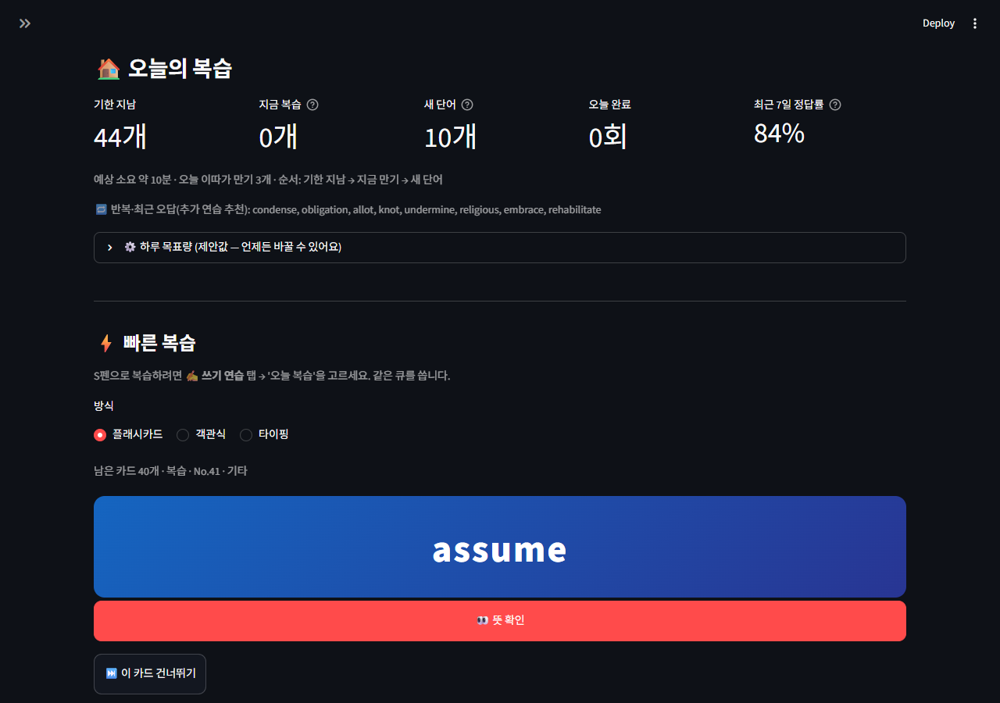
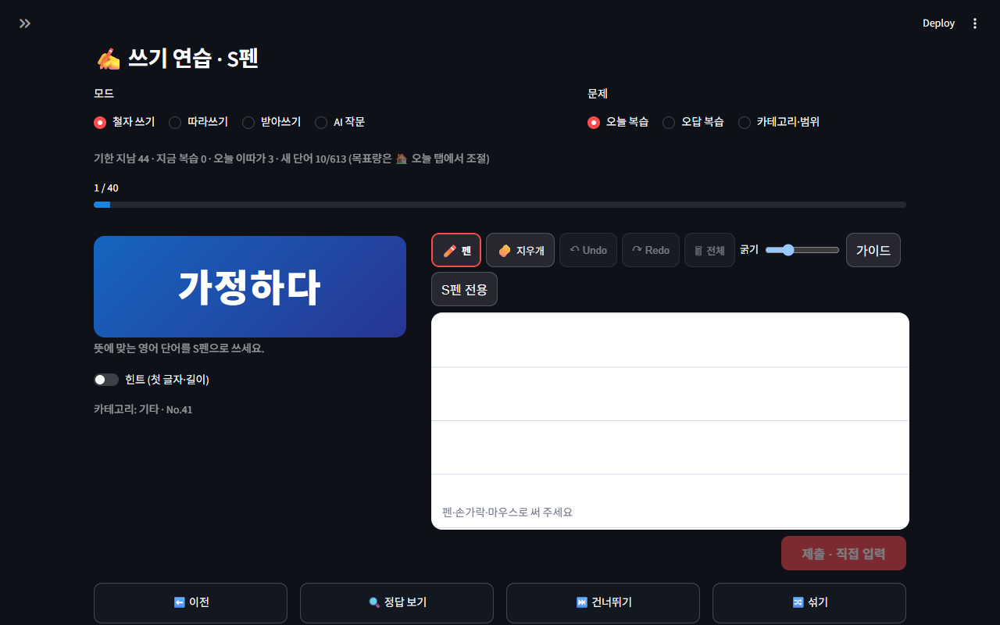
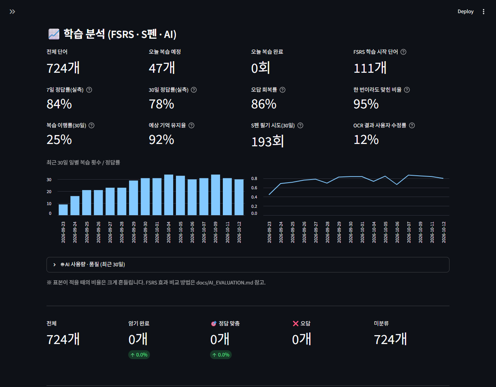
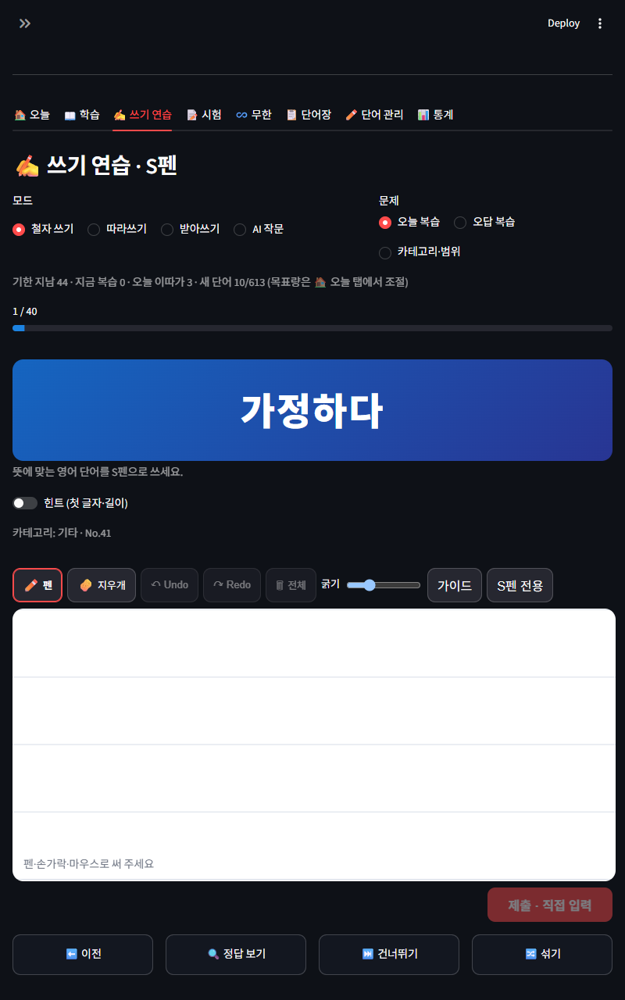

# 📚 WordLoop — 갤럭시탭 S펜으로 쓰는 AI 영단어장

> Excel 영단어장(724단어)으로 시작한 Streamlit 학습 앱을, **S펜 직접 필기 → AI 판독 → 사용자 확인 → FSRS 복습 → PC·태블릿 동기화**까지 이어지는 개인용 학습 도구로 개선한 프로젝트입니다. 무료 사용(Gemini 무료 등급, Supabase 무료 요금제)을 기본값으로 설계했습니다.

**Python · Streamlit 1.65 · Components v2 · Supabase(PostgreSQL+Auth+RLS) · Gemini API · py-fsrs**

기존 배포(v1): <https://honeyenglish.streamlit.app/> — v2는 `feature/wordloop-ai-v2` 브랜치에서 개발 중이며 운영 배포 전입니다.

---

## 1. 이전 버전의 문제

| 문제 | 영향 |
|---|---|
| 진도를 `progress.json` + 브라우저 localStorage에 나눠 저장 | PC와 태블릿 기록이 따로 놀고, 공개 저장소에 학습 기록 파일이 커밋돼 있었음 |
| 손글씨 캔버스를 iframe 안에 두고 다른 스크립트가 iframe DOM을 뒤져 이미지를 꺼냄 | 깨지기 쉬운 결합, 펜/손가락 구분 없음(손바닥 획), 회전·새로고침 시 필기 소실 |
| AI 채점이 `is_correct`를 그대로 신뢰하고 정답 단어를 프롬프트에 넣음 | OCR이 정답 쪽으로 '교정'해 오답이 정답으로 기록될 수 있음 |
| 복습 순서가 무작위 | 언제 무엇을 다시 봐야 하는지 알 수 없음 |
| 화면을 열 때마다 AI 코치를 호출, 724개 예문 일괄 생성 버튼에 한도 없음 | 무료 한도를 쉽게 소진 |

## 2. 개선 아키텍처

```text
[갤럭시탭 Chrome / 삼성 인터넷]                [PC 브라우저]
   └─ S펜 캔버스(Components v2, 벡터 획, IndexedDB 초안)
                 │ 제출 이벤트(PNG)                 │
                 ▼                                  ▼
        Streamlit 앱 (app.py + views/*) ── 기존 7개 탭 유지 + 🏠 오늘 + 📊 분석
                 │
   services/ ─ handwriting(PNG 검증·철자 판정) · ai(Gemini 구조화 출력·캐시·한도·재시도·회로차단)
             ─ study(FSRS 계산 + 멱등 저장) · store(LocalStore | SupabaseStore) · analytics · migrate
                 │                                  │
       로컬 모드: SQLite(이 PC)          로그인 모드: Supabase PostgreSQL (RLS, record_review RPC)
```

자세한 구조는 [docs/ARCHITECTURE.md](docs/ARCHITECTURE.md), 테이블·RLS는 [docs/DATA_MODEL.md](docs/DATA_MODEL.md).

## 3. 기능

| 오늘의 복습 (FSRS) | S펜 쓰기 연습 (가로 40/60) |
|---|---|
|  |  |

| 학습 분석 대시보드 | 세로 모드 |
|---|---|
|  |  |

> 스크린샷의 학습 기록은 `scripts/seed_demo.py`로 만든 **합성 데이터**입니다(실제 사용자 기록 아님). 태블릿 실기기 영상은 아직 없습니다.

- **✍️ S펜 필기**: 철자 쓰기(뜻 → 영단어), 따라쓰기, 받아쓰기(브라우저 TTS), AI 작문(1~3문장 교정)
  - S펜 전용 모드에서는 `pointerType === "pen"`만 획으로 받고 손가락·손바닥 터치는 무시. 펜이 인식되지 않는 브라우저를 위한 터치 호환 토글
  - Undo / Redo / 획 지우개 / 전체 지우기(되돌리기 가능) / 굵기 / 가이드, 44px 이상 버튼
  - 획마다 IndexedDB 초안 저장 → 새로고침·회전·서버 재시작 후 복원, 로그아웃 시 이 기기 초안 삭제
  - 제출하면 AI가 **정답을 모른 채** 글자를 읽고, 사용자가 원본 미리보기를 보며 고친 값을 Python이 채점
  - AI 실패(429·타임아웃·키 없음) 시 필기는 그대로 두고 직접 입력 / 수동 채점
- **🏠 오늘**: 기한 지남 → 지금 만기 → 새 단어 순 큐, 하루 목표량 설정, 예상 소요 시간, 반복 오답, 플래시카드·객관식·타이핑 빠른 복습, Again/Hard/Good/Easy 평가(정오답에 따라 추천만, 결정은 사용자)
- **☁️ 동기화**: 같은 계정으로 PC·태블릿 로그인, 저장 성공을 확인한 뒤에만 "저장됨" 표시, 실패 시 미전송 큐(이 브라우저에 보관, 새로고침해도 유지) + 재전송
- **🤖 AI(Gemini 무료 등급)**: 필기 OCR, AI 토익 문제(문항별 검증·실패 시 로컬 대체·신고), 예문, 단어 자동완성, 작문 교정, 헷갈린 단어 비교, 하루 1회 학습 코치
- **기존 기능 유지**: 플래시카드, 4지선다/주관식/토익 빈칸 시험, 무한 시험, 단어장, 단어 CRUD, Excel 내보내기, 통계

## 4. 기술적 선택

| 선택 | 이유 |
|---|---|
| Streamlit 유지 + `views/`·`services/`로 점진 분리 | 기존 7개 기능 보존, 1인 개발 속도. 별도 프런트엔드 서버 없음 |
| Streamlit **Components v2** 필기 캔버스 | 설치 버전(1.65)에서 양방향 API(`setTriggerValue`)를 확인. iframe DOM 탐색 제거 |
| 벡터 획을 정본으로, PNG는 제출 때만 | 회전·DPR·리사이즈에 강하고 초안 크기가 작음 |
| Supabase + **이메일·비밀번호** 로그인 | 내장 메일 발송 한도가 낮아 매 로그인 OTP는 불편. 비밀번호 방식은 기기마다 메일 없이 로그인 가능 |
| `record_review` RPC (멱등 `attempt_id` + `version` CAS) | PC·태블릿 동시 제출에도 이벤트 1회 반영, 갱신 손실 없음 |
| py-fsrs 공식 기본 파라미터, 퍼징만 끔 | 버튼에 미리 보여준 다음 복습 시각과 실제 저장 시각을 같게 하기 위해 |
| Gemini 구조화 출력 + Pydantic 재검증 | 코드펜스 제거 수준의 파싱을 신뢰하지 않음 |
| MAIN(gemini-3.6-flash) 무응답 시 LITE(gemini-3.5-flash-lite)로 1회 전환 | 개발 중 MAIN이 503을 반복해 실제로 필요했음. 설정으로 끌 수 있고, 화면·사용량 기록에 사용 모델을 남김 |

## 5. 측정 방법

대시보드는 실측 지표와 모델 추정치를 나눠 보여 줍니다: 7/30일 정답률, 오답 회복률(틀렸던 단어를 이후 맞힌 비율)과 한 번이라도 맞힌 비율, 복습 이행률, OCR 결과 사용자 수정률, 수동 채점 수, AI 응답 형식 통과율·캐시 적중률·오류율·신고율, FSRS 예상 기억 유지율(추정치). 🏠 오늘 탭의 **🧪 FSRS vs 무작위 복습 실험**으로 단어를 두 군으로 나눠 같은 복습 횟수에서 재시험 정답률을 비교할 수 있습니다(설계: [docs/AI_EVALUATION.md](docs/AI_EVALUATION.md)). 실제 학습 기록이 쌓이기 전에는 효과 수치를 주장하지 않습니다.

## 6. 한계

- 갤럭시탭 **실기기 검증 전**입니다. PC 브라우저에서 합성 PointerEvent로 검증한 결과와 실기기 체크리스트는 [docs/TABLET_QA.md](docs/TABLET_QA.md).
- OS 수준 손바닥 무시(palm rejection)는 보장하지 않습니다. 브라우저가 보내는 `pointerType`에 의존합니다.
- Gemini 무료 등급 한도는 계정·프로젝트마다 다르고 바뀝니다. 앱은 보수적인 일일 상한(기본 40회/24시간)을 두지만, 결제가 연결된 프로젝트라면 과금될 수 있습니다.
- 무료 API 입력은 공급자 약관상 서비스 개선에 쓰일 수 있습니다. 필기 이미지와 단어 외의 개인정보는 보내지 않습니다.
- 오프라인 완전 동기화(PWA)는 범위 밖입니다. 미전송 기록은 이 기기 브라우저에만 보관되어 다른 기기에서는 보이지 않고, 로그아웃하면 삭제됩니다.
- Supabase·Streamlit Community Cloud 무료 요금제는 일시 중지·용량 제한이 있습니다([docs/DEPLOYMENT.md](docs/DEPLOYMENT.md)).

## 7. 실행

```bash
py -3.12 -m venv .venv
.venv\Scripts\pip install -r requirements-dev.txt
.venv\Scripts\streamlit run app.py
```

- 설정 없이 실행하면 **로컬 모드**: 기존처럼 `Word.xlsx`·`progress.json`을 쓰고, 새 복습 기록은 `data/wordloop.db`(Git 제외)에 저장합니다.
- AI를 켜려면 `.streamlit/secrets.toml.example`을 `.streamlit/secrets.toml`로 복사해 `GEMINI_API_KEY`를 넣습니다. 연결 확인: `.venv\Scripts\python scripts\gemini_smoke.py`
- PC·태블릿 동기화는 Supabase 프로젝트를 만들고 `SUPABASE_URL`, `SUPABASE_ANON_KEY`를 넣은 뒤 마이그레이션을 적용합니다([docs/DEPLOYMENT.md](docs/DEPLOYMENT.md)).
- 갤럭시탭 홈 화면 바로가기를 `.../?tab=write`로 만들면 S펜 쓰기 연습 탭이 바로 열립니다.
- 같은 Wi-Fi의 태블릿에서 PC 서버 접속: `start_server.bat`

### 테스트

```bash
.venv\Scripts\python -m pytest -q                 # AI·DB 없이 (Supabase 테스트는 자동 건너뜀)
node --test tests/js/handwriting.test.mjs         # 필기 컴포넌트 로직
npx supabase start                                # (선택) 로컬 Supabase로 RLS·동기화 통합 테스트
```

Supabase 통합 테스트는 `WORDLOOP_TEST_SUPABASE_URL`, `WORDLOOP_TEST_SUPABASE_ANON_KEY`(로컬 값만)를 설정하면 실행됩니다. CI는 `.github/workflows/tests.yml`.

---

## 기존 기능 화면 (v1)

| 플래시카드 | 시험 | 무한 시험 |
|---|---|---|
|  |  |  |

| 단어장 | 단어 관리 | 통계 |
|---|---|---|
|  |  |  |

## 프로젝트 구조

```text
app.py                      # 진입점: 기존 7개 탭 + 오늘/분석 연결
components/handwriting/     # S펜 캔버스 (Components v2: JS/CSS)
services/                   # ai · handwriting · study(FSRS) · store · migrate · analytics · config
views/                      # account(로그인·동기화) · handwriting · today · dashboard · data_tools · ai_ui
supabase/migrations/        # 스키마 + GRANT + RLS + record_review RPC (되돌리기: supabase/rollback/)
scripts/                    # gemini_smoke.py(무료 API 확인) · seed_demo.py(합성 데모 데이터)
tests/                      # pytest + tests/js (node:test)
docs/                       # ARCHITECTURE · DATA_MODEL · TABLET_QA · AI_EVALUATION · DEPLOYMENT · CHANGELOG_V2
Word.xlsx                   # 원본 단어장 (가져오기·백업용, 앱이 로그인 모드에서는 수정하지 않음)
```
